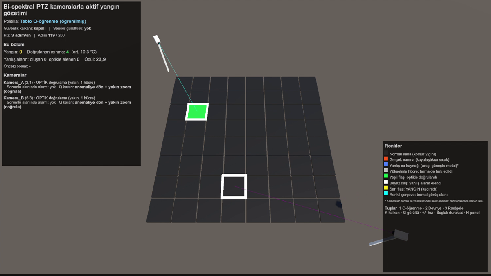
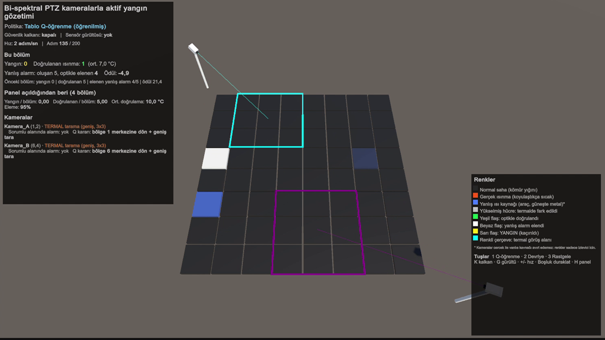
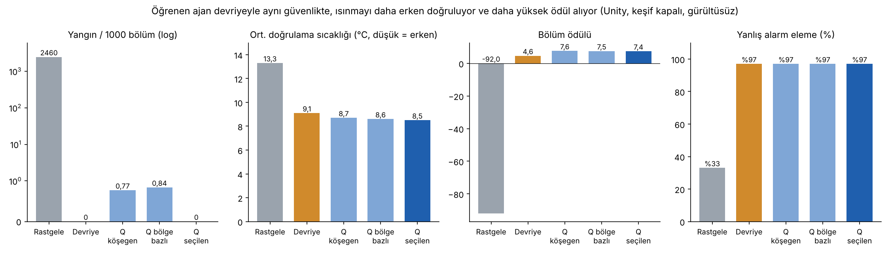
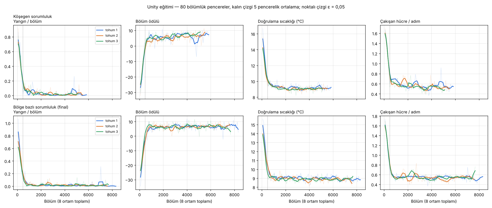
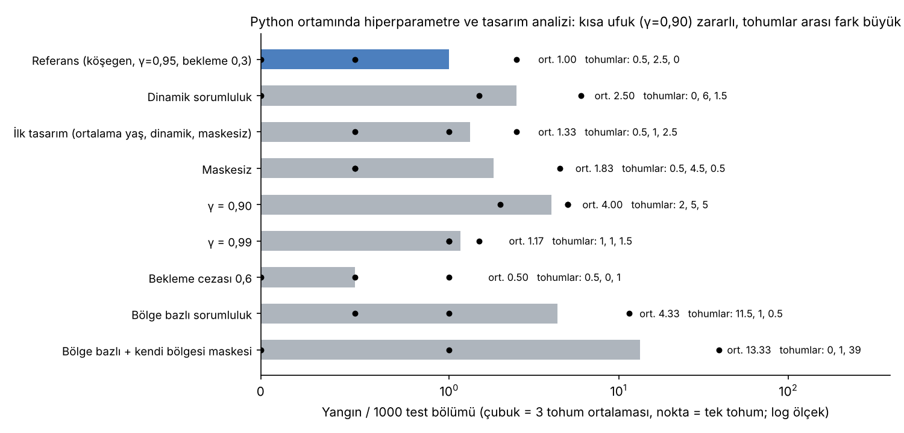
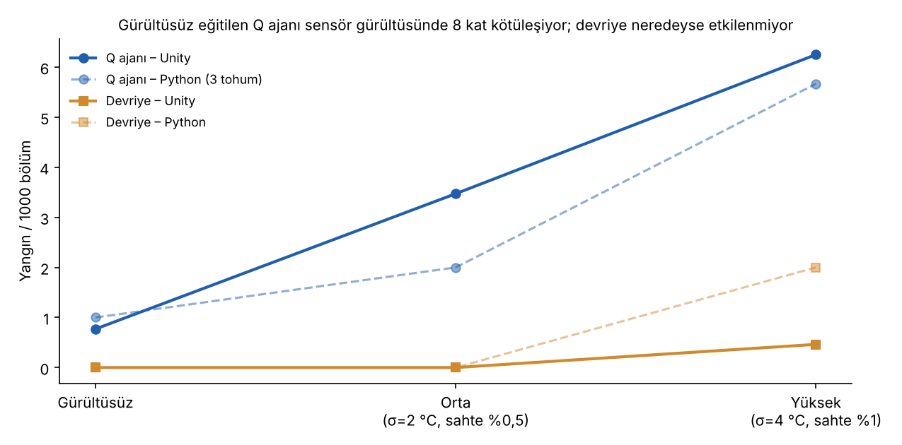
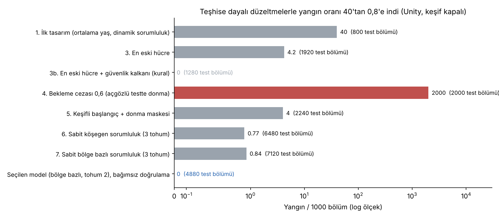

# Bi-spektral PTZ Kameralarla Aktif Yangın/Anomali Gözetimi: Tablo Tabanlı Yarı-Markov Q-Öğrenme

**Ders:** Derin Pekiştirmeli Öğrenme · **Ödev 20** · **Öğrenci No:** 24435004045



---

## Özet

İki bi-spektral PTZ kamera, 8×8 hücrelik bir endüstriyel sahayı **tablo tabanlı yarı-Markov (SMDP) Q-öğrenmeyle** izlemeyi öğrendi. Sinir ağı kullanılmadı. Problem Unity'de simüle edildi; aynı model `gymnasium.Env` uyumlu bir Python ortamında da yazıldı ve iki ortamın sonuçları birbirini doğruladı.

Seçilen ajan, hiç görmediği **4880 test bölümünde (~976 bin adım) sıfır yangın** çıkardı. Isınmaları ortalama **8,5 °C**'de (yangın eşiği 30 °C) optik zoomla doğruladı ve yanlış alarmların **%97**'sini eledi. Elle yazılmış klasik devriye kuralı da yangını önlüyor. Öğrenen ajan ise aynı güvenliği **%60 daha yüksek ödülle** ve ısınmaları daha erken yakalayarak sağlıyor.

Çalışmanın iki temel bulgusu var:
- **Tasarım teşhisle düzeldi.** Simülasyona her yangının nedenini kaydeden bir teşhis eklendi. Bu kayıtlara dayanan düzeltmelerle yangın oranı 1000 bölümde 40'tan 0,8'e indi.
- **Tohumlar arası değişkenlik, tablo yönteminin ana sınırı.** Üç tohumun ortalaması 1000 bölümde 0,8 yangın. Ama bazı eğitimler, nadir görülen "kritik anomali" durumlarını yanlış öğreniyor. Ayrıca gürültüsüz eğitilen ajan sensör gürültüsüne karşı kural tabanlı devriyeden daha kırılgan. Bu iki sınır, final projesinde derin RL'ye geçişin gerekçesidir.

---

## İçindekiler
1. [Giriş ve problem](#1-giriş-ve-problem)
2. [Matematiksel formülasyon](#2-matematiksel-formülasyon)
3. [Simülasyon ortamı](#3-simülasyon-ortamı)
4. [Yöntem: tablo tabanlı SMDP Q-öğrenme](#4-yöntem-tablo-tabanlı-smdp-q-öğrenme)
5. [Klasik yöntemle karşılaştırma](#5-klasik-yöntemle-karşılaştırma)
6. [Eğitim, hiperparametre analizi ve kararlılık](#6-eğitim-hiperparametre-analizi-ve-kararlılık)
7. [Tasarım süreci: teşhis ve düzeltme](#7-tasarım-süreci-teşhis-ve-düzeltme)
8. [Sınırlılıklar ve derin RL'ye geçiş](#8-sınırlılıklar-ve-derin-rlye-geçiş)
9. [Sonuç](#9-sonuç)
10. [Depo yapısı ve çalıştırma](#10-depo-yapısı-ve-çalıştırma)
11. [Kaynaklar](#kaynaklar)

---

## 1. Giriş ve problem

Kömür stok sahaları, enerji santralleri ve geri dönüşüm tesislerinde yangın çoğu zaman yavaş bir ısınmayla (kendiliğinden yanma) başlar. Bu ısınma erken yakalanıp ekip yönlendirilirse yangın hiç çıkmaz. Sorun, sahayı izleyen hareketli kameraların az olmasıdır: bir kamera bir yere bakarken başka yerler kör kalır.

Ödevde kameralar **bi-spektral** PTZ kameralardır: her kamerada aynı kafaya bağlı bir termal ve bir optik sensör vardır. Zoom, ikisinin görüş alanını birlikte belirler:

| Mod | Görüş alanı | Termal sensör | Optik sensör |
| --- | --- | --- | --- |
| **Geniş açı** (termal tarama) | 3×3 hücre | Isıyı fark eder (soğuk anomaliyi kaçırabilir) | Çözünürlük yetersiz: gerçek ısınmayı yanlış ısı kaynağından (araç, güneşte ısınmış metal) **ayıramaz** |
| **Yakın zoom** (optik doğrulama) | 1 hücre | — | Nesneyi tanır: gerçek ısınmayı **doğrular** ya da yanlış alarmı **eler** |

Ajanın ikilemi buradan çıkar. Geniş tarama kör noktaları azaltır ama doğrulayamaz. Yakın zoom doğrular, ama o sırada sahanın geri kalanı izlenmez. İki kameranın aynı yerleri taramaması ve işi paylaşması da ayrıca öğrenilmelidir.

**Kapsam.** Ödev, dersin derin pekiştirmeli öğrenme konularına geçmeden önce **klasik (tablo tabanlı) pekiştirmeli öğrenmeyle** çözülmüştür. Ödevde önerilen yöntemler (Multi-Agent DQN, CTDE PPO) final projesinde aynı ortam üzerinde uygulanacaktır. 8. bölüm, tablo yönteminin nerede yetersiz kaldığını somut verilerle gösterir.

---

## 2. Matematiksel formülasyon

Problem, K = 2 kameralı, kısmen gözlenebilir, sonlu ufuklu (T = 200 adım) bir MDP olarak tanımlandı. Saha N × N = 8 × 8 hücredir.

### 2.1 Durum uzayı S

Ödevdeki üç bileşen doğrudan durumu oluşturur:

| Bileşen | Simge | Boyut | Anlamı |
| --- | --- | --- | --- |
| Belirsizlik yaşı | $y_{ij}$ | 8 × 8 | Hücreye son bakılıştan beri geçen adım sayısı |
| Termal anomaliler | $b_{ij}$ | 8 × 8 | Termal sensörün bildiği sıcaklık tahmini (0 = bilinen anomali yok) |
| Kamera bakış açıları | $(r_k, c_k, z_k)$ | 2 × 3 | Kameranın baktığı hücre ve zoom (0 geniş, 1 yakın) |

Gerçek sıcaklık haritası ve yanlış kaynakların yeri **gizlidir**; ajan onları ancak sensörleriyle görür. Bu yüzden problem kısmen gözlenebilirdir.

### 2.2 Eylem uzayı A

Her kamera her adımda bir Pan / Tilt / Zoom komutu verir:

$$
a_k = (\text{pan}, \text{tilt}, \text{zoom}) \in \{0,-1,+1\} \times \{0,-1,+1\} \times \{\text{genis}, \text{yakin}\}, \qquad |A_k| = 18
$$

Tablo ajanı bu ilkel komutların üzerine **hedef komutları** (makro eylemler) kurar (bkz. 4.2).

### 2.3 Geçiş dinamiği P

Dinamik stokastiktir ve her adımda şu sırayla işler:

1. Kameralar komutu uygular ve algılama yapılır. **Termal** taramada sıcaklığı $T$ olan bir hücre $P(\text{fark}) = \min(1, T/8)$ olasılığıyla fark edilir. **Optik** yakın incelemede gerçek ısınma doğrulanıp söndürülür, yanlış kaynak elenir.
2. Bütün hücrelerin yaşı 1 artar. Doğrulanmamış her gerçek ısınma +1 °C ısınır; 30 °C'ye ulaşan **yangına** döner.
3. Boş bir hücre $p = 0{,}02$ olasılıkla 1 °C'den ısınmaya başlar.
4. Boş bir hücrede $p = 0{,}02$ olasılıkla yanlış bir ısı kaynağı belirir: 6–15 °C, ısınmaz, 20–60 adım sonra kaybolur.
5. Gürbüzlük testinde termal okumaya $\mathcal{N}(0, \sigma^2)$ gürültü eklenir; boş hücreler küçük bir olasılıkla 2–6 °C'lik sahte sıcak nokta gibi görünür.

### 2.4 Ödül fonksiyonu R

Takımın adım başına ödülü, ödevde istenen dört unsuru doğrudan karşılar: erken ve yüksek çözünürlüklü teyit, kör noktalar ve gereksiz motor hareketi.

$$
r_t = \sum_{\text{dogrulanan}} 10\left(1 - \frac{T}{30}\right) + 1 \cdot n_{\text{yeni tespit}} + 0{,}5 \cdot n_{\text{elenen}} - 0{,}05 \cdot n_{\text{hareket}} - 20 \cdot n_{\text{yangin}} - \frac{0{,}5}{64} \sum_{i,j} \frac{\min(y_{ij}, 50)}{50}
$$

Doğrulama ödülü sıcaklıkla doğrusal azalır: 3 °C'de yakalanan bir ısınma +9, 27 °C'de yakalanan +1 kazandırır. Böylece "erken yakalama" ayrı bir kural olmadan ödülün içinde yer alır.

### 2.5 Ödül şekillendirme ve yan etkileri

Tablo ajanının kameraları ayrı ayrı eğitebilmek için takım ödülüne üç **yerel** terim eklendi. Bunlar sadece öğrenmede kullanılır; raporlanan "ödül" her zaman yukarıdaki takım ödülüdür.

- **Sorumluluk alanına göre ceza:** Yangın ve kör nokta cezası, o hücreden sorumlu kameraya yazılır. Takım ödülüyle eğitilen ilk denemelerde iki kamera aynı cezayı aldığı için kimin hatası olduğunu ayıramadı (kredi atama sorunu).
- **Bekleyen alarm cezası (0,3):** Doğrulanmamış her alarm için adım başına $0{,}3 \cdot b_{ij}/30$ ceza. **Yan etkisi:** 0,6'ya çıkarıldığında Q tablosunda birbirine çok yakın değerler oluştu ve açgözlü politikada kameralar yerinde dondu (bkz. 7).
- **Tarama ödülü (0,1):** Taranan hücrelerin normalize yaşı kadar küçük bir ödül. Kör nokta cezasını seyrek olmaktan çıkarır.

Gözlenen en önemli yan etki, **ödülün sömürülmesi** riskidir. Sensör gürültüsü testinde sahte okumalar da "yeni tespit" sayıldığı için +1 ödül aldı. Yüksek gürültüde bölüm ödülü 7,1'den 23,6'ya çıkarken yangın sayısı da arttı. Bu yüzden politikalar ödülle değil; yangın oranı, doğrulama sayısı, doğrulama sıcaklığı ve eleme oranıyla karşılaştırıldı. Gerçek bir sistemde tespit ödülü ancak optik doğrulamadan sonra verilmelidir.

---

## 3. Simülasyon ortamı

Aynı fizik ve ödül modeli iki ortamda kodlandı: görsel ve asıl deneylerin yapıldığı **Unity simülasyonu** ve teslim formatının istediği **`gymnasium.Env` uyumlu Python ortamı**. Python ortamı, Unity sonuçlarını bağımsız olarak yeniden üretmek ve hızlı hiperparametre taraması yapmak için kullanıldı.

### 3.1 Unity simülasyonu

Unity 6 (6000.2.12f1) ve ML-Agents 4.2.0 ile kuruldu. Sahne (`Assets/Scenes/EgitimSahnesi.unity`), aynı prefab'dan üretilmiş **8 paralel ortam** içerir; eğitimde hepsi aynı Q tablosunu günceller.

| Dosya (`Assets/Scripts/`) | Görevi |
| --- | --- |
| `SahaYoneticisi.cs` | Izgara, ısınma ve yanlış kaynak süreçleri, termal/optik algılama, sensör gürültüsü, yangın teşhisi, hücre renkleri |
| `PTZKameraAjani.cs` | Kamera ajanı: Pan/Tilt/Zoom, Q-öğrenme ve devriye politikaları, görüş çerçevesi |
| `OrtamKontrolcusu.cs` | Zaman akışı, takım ve yerel ödüller, sorumluluk paylaşımı, bölüm sonu, değerlendirme kayıtları |
| `QOgrenme.cs`, `QOgrenmeYoneticisi.cs` | Q tablosu, güncelleme kuralı, ε takvimi, tohum, kayıt/yükleme, öğrenme eğrisi |
| `KontrolPaneli.cs` | Sunum modu: tek ortama odak, canlı istatistik paneli, politika/gürültü/hız geçişi |



Renkler sadece izleyici içindir; kameralar gerçek ile yanlış kaynağı ayırt edemez. Gerçek ısınma turuncu-kırmızı, yanlış kaynak mavi gösterilir. Termalde fark edilen hücre yükselir. Optik doğrulamada hücre yeşil, yanlış alarm elendiğinde beyaz, yangında sarı yanıp söner. Kameranın görüş çerçevesi termal modda 3×3 ve renkli, optik modda tek hücre ve beyazdır.

Her yangında simülasyon bir **teşhis kaydı** yazar: yangına dönen anomali termalde görülmüş müydü, üzerinden geçildiği halde mi kaçırıldı, yoksa hücreye hiç mi bakılmadı? Kayıtta ayrıca anomalinin ilk fark edildiği sıcaklık, kameraların uzaklığı ve o anki kararları da bulunur. Tasarım düzeltmelerinin hepsi bu kayıtlardan çıktı (bkz. 7).

### 3.2 Gymnasium ortamı

`python/ptz_gozetim_env.py` içindeki `PTZGozetimEnv`, `gymnasium.Env` arayüzünü uygular ve `gymnasium.utils.env_checker.check_env` testini geçer.

- `observation_space`: `Dict(yas: Box(8×8), anomali: Box(8×8), kameralar: Box(2×3))`
- `action_space`: `MultiDiscrete([3, 3, 2] × 2)` (kamera başına pan, tilt, zoom)
- `reset(seed)` tekrarlanabilir bölüm üretir. `step`, takım ödülünü döndürür; `info` içinde kamera başına ödül, yangın teşhisi ve istatistikler bulunur.

### 3.3 İki ortamın tutarlılığı

| Politika | Ölçüt | Unity | Python |
| --- | --- | --- | --- |
| Rastgele | Yangın / bölüm | 2,46 | 2,60 |
| Rastgele | Bölüm ödülü | −92,0 | −94,6 |
| Rastgele | Doğrulanan / bölüm | 1,10 | 1,11 |
| Q ajanı (köşegen, 3 tohum) | Yangın / 1000 bölüm | 0,77 | 1,00 |
| Q ajanı, yüksek gürültü | Yangın / 1000 bölüm | 6,25 | 5,67 |

Temel davranış ve gürültüye tepki iki ortamda aynıdır. Bir fark var: Unity'de büyük etki yaratan bazı tasarım değişiklikleri Python'da çok daha küçük etki gösterdi (bkz. 8). Tasarım kararları bu yüzden Unity verisine dayandırıldı.

---

## 4. Yöntem: tablo tabanlı SMDP Q-öğrenme

Tam durum (iki 8×8 harita ve kamera konumları) bir tabloya sığmaz. Bu yüzden durum 36 hücreye sıkıştırıldı ve eylemler birkaç adım süren hedef komutlarına dönüştürüldü. İki kamera aynı Q tablosunu paylaşır, ama her biri kendi sorumluluk alanını görür.

### 4.1 Sıkıştırılmış durum (36)

$$
s = 9 \cdot \text{aciliyet} + \text{en eski bolge}, \qquad \text{aciliyet} \in \{0,1,2,3\},\quad \text{en eski bolge} \in \{0, \dots, 8\}
$$

- **Aciliyet** (termal anomali bileşeninden): Kameranın sorumlu olduğu en sıcak bilinen anomali. 0 = yok, 1 = 10 °C'nin altı, 2 = 10–18 °C, 3 = 18 °C ve üstü.
- **En eski bölge** (belirsizlik yaşı bileşeninden): Saha 9 bölgeye (B0–B8, 3×3, 3×2 ve 2×2 hücrelik) ayrılır. Kameranın sorumlu olduğu bölgeler arasından, içindeki **en uzun süredir bakılmayan hücrenin** yaşı en büyük olan seçilir.
- **Kamera bakış açıları** durumda dolaylı yer alır: Sorumluluk alanı ve eylem maskeleri kameranın konumuna göre hesaplanır.

### 4.2 Makro eylemler (10 hedef komutu)

| Eylem | Pan/Tilt hedefi | Zoom |
| --- | --- | --- |
| `tara_B0` … `tara_B8` | Seçilen bölgenin merkez hücresi | Geniş (termal tarama) |
| `dogrula` | Sorumlu olunan en sıcak bilinen anomali | Hedefe 1 hücre kala yakın (optik doğrulama) |

Kamera hedefe her adım bir hücre (çapraz dahil) ilerler ve yolda termal tarama yapar. Eylem şu durumlardan biri gerçekleşince biter ve yeni karar verilir:
- hedefe varılır,
- eylem 12 adımı doldurur,
- tarama sırasında yeni bir anomali fark edilir,
- doğrulanacak anomali ortadan kalkar.

**Geçersiz eylem maskeleri:** Bilinen anomali yokken `dogrula` seçilemez. Kameranın zaten merkezinde durduğu bölge de seçilemez, çünkü bu eylem hareket üretmez ve açgözlü politikada kamerayı yerinde dondurabilir (bkz. 7).

### 4.3 Güncelleme kuralı

Eylemler farklı sürelerde bittiği için yarı-Markov (SMDP) Q-öğrenme kullanıldı [2, 3]. τ adım süren bir eylem için:

$$
Q(s,a) \leftarrow Q(s,a) + \alpha_n \left[ \sum_{k=0}^{\tau-1} \gamma^k r_{t+k} + \gamma^{\tau} \max_{a' \in A(s')} Q(s',a') - Q(s,a) \right], \qquad \alpha_n = \max\left(0{,}01,\; n^{-0{,}7}\right)
$$

Burada $n$, $(s,a)$ çiftinin kaçıncı kez güncellendiği; $A(s')$ ise maskelenmiş geçerli eylemlerdir. Ziyaretle azalan öğrenme hızı, sabit α ile görülen salınımları giderdi. Keşif, ε-açgözlü ile yapılır; test sırasında ε = 0'dır.

### 4.4 Sorumluluk paylaşımı

Her hücreden tek bir kamera sorumludur: Yangın ve kör nokta cezası ona yazılır ve `dogrula` sadece onun anomalilerine yönelir. Üç paylaşım denendi:

- **Dinamik:** Hücre, o an kendisine en yakın kameranındır. Kameralar hareket ettikçe sorumluluk el değiştirir.
- **Sabit köşegen:** Saha köşegenle ikiye bölünür.
- **Sabit bölge bazlı (final):** B0–B3 Kamera A'nın (33 hücre), B4–B8 Kamera B'nin (31 hücre). Bir hücreyi tarayan kamera ile ondan sorumlu kamera her zaman aynıdır.

### 4.5 Hiperparametreler

| Parametre | Değer |
| --- | --- |
| İndirim γ | 0,95 |
| Öğrenme hızı α | max(0,01, n^−0,7) |
| ε-açgözlü | 1,0 → 0,05, ilk 60 000 kararda doğrusal; testte 0 |
| Makro eylem süresi üst sınırı | 12 adım |
| Bekleyen alarm cezası / tarama ödülü | 0,3 / 0,1 |
| Eğitim süresi | ~0,7–1,1 milyon karar (Unity'de 8 ortamla ~10 dakika) |

---

## 5. Klasik yöntemle karşılaştırma

**Klasik yöntem (devriye):** Saha iki dikey şeride bölünür ve her kamera kendi şeridinden sorumludur. Şeridinde bilinen bir anomali varsa en sıcağına gider ve yanına varınca yakın zoomla doğrular. Anomali yoksa şeridindeki en uzun süredir bakılmayan hücreye gider (eşitlikte en yakınına). Bu, açgözlü "en eski noktayı tara, alarmı hemen doğrula" kuralıdır ve ortamı bilen biri tarafından elle yazılmıştır.

Tüm testler Unity'de, keşif kapalıyken (ε = 0) ve gürültüsüz ortamda yapıldı:

| Politika | Test bölümü | Yangın / 1000 bölüm | Bölüm ödülü | Doğrulanan / bölüm | Ort. doğrulama sıcaklığı (°C) | Yanlış alarm eleme | Çakışan hücre / adım |
| --- | ---: | ---: | ---: | ---: | ---: | ---: | ---: |
| Rastgele | 880 | 2460 | −92,0 | 1,10 | 13,3 | %33 | 0,26 |
| Devriye (klasik kural) | 800 | 0 | 4,6 | 3,70 | 9,1 | %97 | 0,27 |
| Q, köşegen sorumluluk (3 tohum) | 6480 | 0,77 | 7,6 | 3,81 | 8,7 | %97 | 0,43 |
| Q, bölge bazlı sorumluluk (3 tohum) | 7200 | 0,83 | 7,6 | 3,82 | 8,6 | %97 | 0,47 |
| **Q, seçilen model (bağımsız doğrulama)** | **2400** | **0** | **7,4** | **3,76** | **8,5** | **%97** | — |



- **Güvenlik:** Devriye ve seçilen Q modeli testte hiç yangın çıkarmadı. Üç tohumun ortalamasında Q ajanı 1000 bölümde 0,8 yangın çıkarıyor; yani ortalamada devriye kadar güvenilir değil (bkz. 6).
- **Verimlilik:** Q ajanı devriyeden %60 daha yüksek ödül alıyor, ısınmaları yaklaşık 0,6 °C daha erken doğruluyor ve gereksiz motor hareketini azaltıyor. Ajana hiçbir strateji verilmedi; bu davranışı sadece ödülden çıkardı.
- **Bedel:** Q ajanında kameraların görüş alanı daha sık çakışıyor (0,43–0,47'ye karşı 0,27). Sorumluluk sınırının yakınındaki hücreler ara sıra iki kamera tarafından birlikte taranıyor.

---

## 6. Eğitim, hiperparametre analizi ve kararlılık

### 6.1 Öğrenme eğrileri (3 tohum)



Üst satır köşegen, alt satır bölge bazlı (final) sorumlulukla yapılan eğitimlerdir; her biri 3 bağımsız tohumla (1, 2, 3) eğitildi. Altı eğitimin hepsi aynı seviyeye ulaşıyor. Öğrenmenin büyük kısmı ε'nin 0,05'e indiği ilk ~1000 bölümde tamamlanıyor:
- yangın, bölüm başına 0,9'dan 0,05'in altına,
- doğrulama sıcaklığı 16 °C'den 9 °C'ye,
- kamera çakışması 1,7 hücreden 0,5 hücreye iniyor.

Sonrasındaki dalgalanmalar, %5 rastgele keşiften ve 80 bölümlük pencerelerde yangının nadir bir olay olmasından kaynaklanıyor. İki sorumluluk şemasının eğrileri neredeyse aynı. Fark, eğitim eğrisinde değil, keşif kapatıldığında tek tek tohumların nadir kritik durumlardaki davranışında ortaya çıkıyor (6.2). Ham veriler `docs/egriler/` klasöründe; grafik `python/unity_egrileri.py` ile üretilir.

### 6.2 Kararlılık: tohumlar arası değişkenlik

| Unity, kalkansız, keşif kapalı | Tohum 1 | Tohum 2 | Tohum 3 | Toplam |
| --- | ---: | ---: | ---: | ---: |
| Köşegen sorumluluk | 1 / 2160 | 4 / 2080 | 0 / 2240 | **5 / 6480 → 0,77 / 1000** |
| Bölge bazlı sorumluluk | 0 / 2320 | 0 / 2480 | 6 / 2400 | **6 / 7200 → 0,83 / 1000** |

İki tasarımın ortalaması aynıdır. Ama tek tek eğitimler arasında belirgin fark var: aynı ayarlarla bir eğitim kusursuz bir politika öğrenirken diğeri 2400 bölümde 6 yangın çıkarabiliyor. Kötü tohumlar adım adım izlendiğinde ortak neden görüldü. Q tablosunun **"kritik anomali var"** satırları (aciliyet 3) eğitimde çok seyrek ziyaret ediliyor ve az örnekle, şansa bağlı öğreniliyor. Örneğin bir eğitimde, alanında kritik bir ısınma olan kamera onu doğrulamak yerine diğer kameranın bölgesini taramaya gidip iki hedef arasında gidip geldi. Bu, tablo yönteminin temel sınırıdır ve teslim formatının neden en az 3 tohum istediğini de gösterir.

**Model seçimi:** Sunum ve final için bölge bazlı tohum 2 seçildi. Seçim aynı test bölümlerine bakılarak yapıldığı için, iyi sonucun şans eseri olmadığını görmek amacıyla model farklı bir rastgele tohumla üretilen **2400 yeni bölümde** yeniden test edildi ve yine **0 yangın** çıkardı. Toplam 4880 bölümde sıfır yangın, gerçek oranın %95 güvenle 1000 bölümde 0,6'nın altında olduğunu gösterir.

### 6.3 Hiperparametre ve tasarım analizi

Analiz, hızlı olduğu için Python ortamında yapıldı. Her yapılandırma 3 tohumla 5000 bölüm eğitildi ve 2000 bölüm test edildi.



| Yapılandırma | Yangın / 1000 (3 tohum ort.) | Tohumlar | Bölüm ödülü |
| --- | ---: | --- | ---: |
| Referans (köşegen, γ = 0,95, bekleme 0,3) | 1,00 | 0,5 · 2,5 · 0 | 7,7 |
| γ = 0,90 | **4,00** | 2 · 5 · 5 | 8,2 |
| γ = 0,99 | 1,17 | 1 · 1 · 1,5 | 7,9 |
| Bekleme cezası 0,6 | 0,50 | 0,5 · 0 · 1 | 8,1 |
| Donma maskesi yok | 1,83 | 0,5 · 4,5 · 0,5 | 8,2 |
| Dinamik sorumluluk | 2,50 | 0 · 6 · 1,5 | 8,5 |
| İlk tasarım (ortalama yaş, dinamik, maskesiz) | 1,33 | 0,5 · 1 · 2,5 | 8,8 |
| Bölge bazlı sorumluluk | 4,33 | 11,5 · 1 · 0,5 | 8,2 |
| Bölge bazlı + yalnız kendi bölgesini tara | 13,33 | 0 · 1 · 39 | 7,7 |

- **Kısa ufuk zararlı:** γ = 0,90'da üç tohumun da yangın oranı yüksek. Ajan, uzaktaki kör noktaların birkaç on adım sonraki riskini yeterince hesaba katmıyor.
- **Donma maskesi işe yarıyor:** Maskesiz ajanda "hiç bakılmadı" kaynaklı yangınlar görüldü. Maskeyle birlikte bekleme cezası 0,6 da artık sorunsuz çalışıyor.
- **Kısıtlamalar her zaman yardım etmiyor:** Kameranın yalnızca kendi bölgelerini taramasına izin veren kural bir tohumda 39/1000'e çöktü.
- **Python, Unity'deki tasarım farklarını küçük gösteriyor:** Örneğin ilk tasarım Unity'de 40/1000 iken Python'da 1,3/1000. Bu sınırlılık 8. bölümde tartışılıyor.

### 6.4 Sensör gürültüsüne gürbüzlük

Gürültüsüz ortamda eğitilen ajanlar, termal okumaya Gauss gürültüsü ve sahte sıcak noktalar eklenerek test edildi.



| Yangın / 1000 bölüm | Gürültüsüz | Orta (σ = 2 °C, sahte %0,5) | Yüksek (σ = 4 °C, sahte %1) |
| --- | ---: | ---: | ---: |
| Q ajanı — Unity | 0,77 | 3,5 | 6,25 |
| Q ajanı — Python (3 tohum) | 1,0 | 2,0 | 5,7 |
| Devriye — Unity | 0 | 0 | 0,46 |
| Devriye — Python | 0 | 0 | 2,0 |

Q ajanında doğrulama sayısı (~3,8/bölüm) ve yanlış alarm eleme oranı (%96) korunuyor, ama yangın oranı ~8 kat artıyor. Yangın kayıtları iki mekanizma gösteriyor:
1. **Gürültülü sıcaklık tahmini aciliyet seviyesini bozuyor:** 29 °C'deki bir ısınma 31 °C, 12 °C'deki biri 8 °C okunabiliyor.
2. **Sahte okumalar kameraların zamanını alıyor:** Kameralar, yerini kontrol etmesi gereken sahte noktalar yüzünden gerçek ısınmalara geç kalıyor.

Devriye, aciliyet seviyesine göre karar vermediği için gürültüden çok daha az etkileniyor. Doğal çözüm, ajanı gürültülü ortamda eğitmektir (alan rastgeleleştirme).

---

## 7. Tasarım süreci: teşhis ve düzeltme

Final tasarım, her adımda yangınların **nedenini ölçüp** ona göre yapılan düzeltmelerle ortaya çıktı. Sayılar Unity'de, keşif kapalı testlerden alınmıştır.



1. **İlk tasarım: 40 yangın / 1000 bölüm.** Durum, bölgelerin **ortalama** yaşını kullanıyordu. Teşhis kayıtlarına göre yangınların %90'ı (49'da 44) ısınma boyunca **hiç bakılmayan** hücrelerden çıktı. Sekiz hücresi yeni taranmış bir bölgede unutulmuş tek bir köşe, ortalamada görünmüyordu.
2. **Güvenlik kalkanı denendi, etkisiz kaldı.** Bilinen 18 °C üstü anomaliye kamerayı zorla gönderen kural yangını azaltmadı, çünkü yangınlar bilinmeyen anomalilerden çıkıyordu.
3. **En eski hücre: 4,2 / 1000.** Bölge yaşı, bölgedeki en uzun süredir bakılmayan hücreye göre hesaplandı. "Hiç bakılmadı" kaynaklı yangınlar sıfıra indi. Kalan yangınlar bilinen ama zamanında doğrulanamayan anomalilerdi. Bu aşamada kalkan eklenince 1280 bölümde 0 yangın elde edildi.
4. **Bekleme cezası 0,6: başarısız.** Eğitimde iyi göründü, ama keşif kapatılınca yangın bölüm başına 2'ye fırladı. Q tablosundaki eşite yakın değerler, kameranın kendi bulunduğu bölgeyi tekrar tekrar seçip **yerinde donmasına** yol açtı. Eğitimdeki %5 rastgele hamle bu döngüyü kırdığı için sorun ancak açgözlü testte görüldü. Çözüm: donma maskesi.
5. **Keşifli başlangıç: etkisiz.** Eğitim bölümlerinin yarısı önceden ısınmış hücrelerle başlatıldı; amaç nadir kritik durumların daha sık yaşanmasıydı. Yangın oranı değişmedi (4,0 / 1000).
6. **Sabit köşegen sorumluluk: 0,77 / 1000 (3 tohum).** Yangınların çoğu iki kameraya eşit uzaklıktaki köşelerde çıkıyordu. Kameralar hareket ettikçe sorumluluk el değiştiriyor ve köşe kimsenin "asıl işi" olmuyordu.
7. **Sabit bölge bazlı sorumluluk: 0,83 / 1000 (3 tohum), seçilen model 0 / 4880.** Simülasyon videosu incelendiğinde bir köşe hücresinin 29 °C'de, yangına bir adım kala doğrulandığı görüldü. O hücreyi tarayan bölgenin merkezi A'nın alanındaydı, hücre ise B'nin sorumluluğundaydı: bilgi A'da, sorumluluk B'deydi. Sorumluluk bölgelere göre bölününce bu uyumsuzluk kalktı.

Sürecin genel dersi şudur: **ajanın ne gördüğü (durum) ve neyden sorumlu olduğu (ödül), birbiriyle ve fiziksel kapsama ile tutarlı olmalıdır.** Düzeltmelerin hepsi bu üçü arasındaki bir uyumsuzluğu gideriyor.

---

## 8. Sınırlılıklar ve derin RL'ye geçiş

1. **Durum sıkıştırması bilgi kaybettiriyor.** 36 durum; anomalinin kameraya uzaklığını, aynı anda birden fazla anomali olup olmadığını ve diğer kameranın ne yaptığını içermiyor. Farklı durumlar ajana aynı görünüyor ve aynı karar veriliyor. Bu bilgiler tabloya eklenirse durum sayısı katlanarak artar ve her durum daha az örnekle öğrenilir.
2. **Nadir durumlar güvenilir öğrenilemiyor.** Yangına yol açan kritik durumlar eğitimde seyrek görüldüğü için Q değerleri gürültülü kalıyor. Sonuç, tohumlar arası büyük değişkenlik (6.2).
3. **Gürültüye karşı kırılganlık.** Gürültüsüz eğitilen politika, aciliyet seviyesinin keskin eşiklerine bağlı olduğu için gürültülü okumalarda kural tabanlı devriyeden daha çok bozuluyor (6.4).
4. **İki simülasyonun duyarlılık farkı.** Python ortamı ortalama davranışı ve gürültü etkisini doğru üretiyor, ama Unity'deki tasarım farklarını küçük gösteriyor. Olası nedenler: Unity'de 8 ortamın aynı tabloyu eşzamanlı güncellemesi ve adım sırasındaki küçük farklar.
5. **Bi-spektral modelin basitleştirilmesi.** Optik sensör geniş açıda bilgi vermiyor, yakın zoomda kesin sonuç veriyor. Gerçekte optik tanıma da olasılıksal bir hata payı taşır.

**Derin RL'den beklenen.** Final projesinde aynı ortam üzerinde Multi-Agent DQN veya CTDE PPO uygulanacaktır.
- **Sıkıştırma kaybını gidermek:** Bir sinir ağı, iki 8×8 haritanın tamamını ve diğer kameranın konumunu girdi olarak alabilir ve benzer durumlar arasında genelleme yapabilir (1. ve 2. sınırlılık).
- **Koordinasyonu öğrenmek:** CTDE, kameraların eğitimde birbirinin durumunu görerek iş paylaşmayı öğrenmesini sağlar.
- **Gürültüye dayanıklılık:** Eğitime gürültü eklenerek gürbüzlük doğrudan hedeflenebilir (3. sınırlılık).

---

## 9. Sonuç

Bi-spektral PTZ kameralarla yangın gözetimi, Pan/Tilt/Zoom hedef komutları üzerinde tanımlanan bir yarı-Markov karar problemi olarak modellendi ve tablo tabanlı Q-öğrenmeyle çözüldü. Öğrenen ajan:
- hiçbir strateji verilmeden, sadece ödülden; termalle geniş tarama ve optikle yakın doğrulama arasındaki dengeyi kurmayı öğrendi,
- ısınmaları ortalama 8,5 °C'de, yangın eşiğinin üçte birinden önce yakaladı,
- yanlış alarmların %97'sini eledi,
- seçilen modelle 4880 test bölümünde hiç yangın çıkarmadı.

Kural tabanlı devriyeyle aynı güvenliği daha yüksek verimle sağladı. Ama tohumlar arası değişkenlik ve sensör gürültüsüne duyarlılık, sıkıştırılmış tablo temsilinin sınırlarını açıkça gösterdi. Bu sınırlar, final projesindeki derin pekiştirmeli öğrenme çalışmasının çıkış noktasıdır.

---

## 10. Depo yapısı ve çalıştırma

```
TermalGozetim/
├── Assets/
│   ├── Scenes/EgitimSahnesi.unity      # 8 paralel ortamlı sahne
│   ├── Scripts/                        # C# kaynak kodları (bkz. 3.1)
│   └── Ortam.prefab                    # tek ortam: saha + 2 kamera + kontrolcü
├── QTablolari/                         # eğitilmiş Q tabloları ve öğrenme eğrileri (CSV)
│   └── qtablo_bolge_t2.bin             # seçilen final model
├── python/                             # gymnasium ortamı ve deney betikleri
│   ├── ptz_gozetim_env.py              # PTZGozetimEnv (gymnasium.Env)
│   ├── politikalar.py                  # Rastgele, Devriye, QAjani
│   ├── deney.py                        # eğitim / değerlendirme
│   ├── calistir.py                     # tüm deneyler (3 tohum)
│   ├── gurultu_testi.py                # gürbüzlük testi
│   ├── grafikler.py                    # Python grafikleri
│   ├── unity_egrileri.py               # Unity öğrenme eğrisi grafiği
│   └── sonuclar/                       # deney sonuçları (JSON) ve Q tabloları
├── docs/
│   ├── gorseller/                      # README şekilleri
│   └── egriler/                        # Unity öğrenme eğrileri (CSV, 6 eğitim)
├── Packages/, ProjectSettings/         # Unity proje ayarları
└── README.md
```

### Unity

Gereksinimler: Unity **6000.2.12f1**, ML-Agents paketi **4.2.0** (Package Manager'dan kurulur).

1. Projeyi Unity Hub ile açın ve `Assets/Scenes/EgitimSahnesi` sahnesini açın.
2. **İzleme / sunum:** `KontrolPaneli` nesnesi etkin olsun. `QOgrenme` nesnesinde Tablo Dosyasi = `qtablo_bolge_t2.bin`, Ogrenme Aktif = kapalı olsun. Play'e basın. Tuşlar: `1` Q-öğrenme, `2` Devriye, `3` Rastgele, `K` güvenlik kalkanı, `G` sensör gürültüsü, `+`/`−` hız, `Boşluk` duraklat, `H` panel.
3. **Eğitim:** `KontrolPaneli` nesnesini devre dışı bırakın. `QOgrenme` nesnesinde yeni bir Tablo Dosyasi adı ve Tohum seçin, Ogrenme Aktif = açık yapın. Prefab ayarları:
   - Kameralar: Heuristic Modu = QOgrenme
   - OrtamKontrolcusu: Sabit Sorumluluk ✓, Bolge Bazli Sorumluluk ✓, Zaman Olcegi = 20
   - Saha: Yanlis Kaynaklar ✓
   
   Play'e basın. ~700 bin kararda (~10 dk) durdurun.
4. **Değerlendirme:** Ogrenme Aktif'i kapatın ve Play'e basın. Console'daki `[DEĞERLENDİRME]` satırları kümülatif sonuçları, `[YANGIN]` satırları her yangının teşhisini verir.

### Python

```bash
cd python
pip install -r requirements.txt
python ptz_gozetim_env.py                  # check_env + örnek rastgele bölüm
python deney.py baseline --test 1000        # devriye ve rastgele
python deney.py egit --tohum 1 --etiket final --bolum 5000 --test 2000
python calistir.py                          # tüm hiperparametre/tasarım deneyleri (3 tohum)
python gurultu_testi.py 1000                # gürbüzlük testi
python grafikler.py                         # öğrenme eğrileri ve özet tablo
```

---

## Kaynaklar

1. R. S. Sutton, A. G. Barto. *Reinforcement Learning: An Introduction*, 2. baskı. MIT Press, 2018.
2. R. S. Sutton, D. Precup, S. Singh. "Between MDPs and semi-MDPs: A framework for temporal abstraction in reinforcement learning." *Artificial Intelligence*, 112(1–2), 181–211, 1999.
3. S. J. Bradtke, M. O. Duff. "Reinforcement learning methods for continuous-time Markov decision problems." *NIPS 7*, 1995.
4. C. J. C. H. Watkins, P. Dayan. "Q-learning." *Machine Learning*, 8, 279–292, 1992.
5. A. Y. Ng, D. Harada, S. Russell. "Policy invariance under reward transformations: Theory and application to reward shaping." *ICML*, 1999.
6. A. Juliani ve ark. "Unity: A general platform for intelligent agents." arXiv:1809.02627, 2018.
7. M. Towers ve ark. "Gymnasium: A standard interface for reinforcement learning environments." arXiv:2407.17032, 2024.
